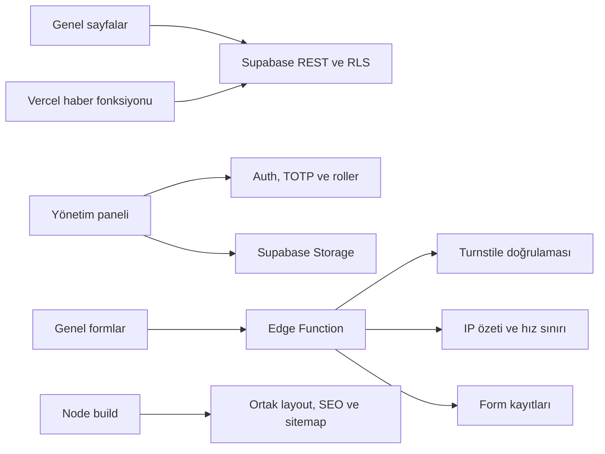

# BABDER

Şanlıurfa Siverek Kapıkaya Bab Köyü ve Köyleri Sosyal Yardımlaşma ve Dayanışma Derneği için saf HTML/CSS/ES modules web sitesi ve Supabase yönetim paneli.

## Mimari



`partials/` header, footer ve çerez alanının tek kaynağıdır. Build bunları statik HTML'e yerleştirir; tarayıcıda layout yüklenmesini beklemek gerekmez. Sayfaların başlık, meta açıklaması ve H1 değerleri kendi HTML'lerinde kalır. `dist/` üretilen dağıtım dizinidir.

## Kurulum ve dağıtım

1. `js/config.js` içindeki Supabase URL ve mevcut anon anahtarını doğrulayın. service_role anahtarını istemci koduna eklemeyin.
2. `SITE_URL` şu an `https://babder.vercel.app` olarak ayarlıdır. Canonical, Open Graph ve sitemap buradan üretilir. `babder.org` alındığında bu değeri, Turnstile domain izinlerini ve `FORM_ALLOWED_ORIGINS` ayarını güncelleyin.
3. Supabase Auth'ta yeni kullanıcı kaydını kapatın. Auth Users üzerinden yöneticileri oluşturup UUID'lerini `yoneticiler` tablosuna admin/editor/goruntuleyici rolüyle ekleyin.
4. Supabase TOTP'nin açık olduğunu doğrulayın. Admin girişinde kurulum anahtarını doğrulama uygulamasına ekleyip altı haneli kodu girin. Editör paneldeki iki adımlı doğrulama düğmesiyle isteğe bağlı kurulum yapabilir.
5. Cloudflare Turnstile widget oluşturun, domain izinlerini ayarlayın ve halka açık site anahtarını `TURNSTILE_SITE_KEY` değerine yazın.
6. Supabase secrets alanında `TURNSTILE_SECRET_KEY`, güçlü rastgele `FORM_IP_SALT` ve virgülle ayrılmış tam HTTPS adreslerinden oluşan `FORM_ALLOWED_ORIGINS` tanımlayın. SUPABASE_URL ve SUPABASE_SERVICE_ROLE_KEY yalnızca fonksiyon ortamından alınır.
7. `supabase functions deploy form-gonder` ile fonksiyonu dağıtın. Origin, Turnstile hostname/action, alanlar ve KVKK onayı doğrulanır. Gateway'in eklediği son X-Forwarded-For adresinin tuzlanmış SHA-256 özetiyle saatlik 5 istek sınırı atomik uygulanır; IP açık metin olarak saklanmaz.
8. Mevcut verileri yedekledikten sonra güncel `supabase/schema.sql` dosyasını SQL Editor'de çalıştırın. Bu SQL yeni tabloları/RLS/trigger'ları oluşturur, anonim form INSERT izinlerini kaldırır ve admin işlemlerinde AAL2 ister. Tekrar çalıştırılabilir tanımlanmıştır.
9. `pnpm install --frozen-lockfile` ve `pnpm run build` çalıştırın. Build yalnızca Node standart kütüphanesini kullanır; dev bağımlılıklar kalite kontrolleri içindir. Vercel aynı build'i çalıştırıp `dist/` dizinini yayımlar.

`/haber/:slug` Vercel fonksiyonu yalnızca yayımlanmış haberleri getirir, slug'ı doğrular ve HTML escape ile başlık/paylaşım etiketlerini üretir. Bulunmayan haber 404 döndürür. `node scripts/serve.mjs` yalnızca statik yerel önizleme sunar; Vercel haber fonksiyonunu çalıştırmaz.

## İçerik ve yetkiler

Panel haber, duyuru, etkinlik, taziye, kampanya, CMS sayfası/bölümü, ana sayfa, menü, köy, kurul, albüm, galeri, belge, başvuru, mesaj, üye, aidat ve medya yönetimini içerir. Roller RLS ile sınırlandırılır. `editor_yayinlayabilir` kapalıyken editörün yeni yayın isteği incelemeye çevrilir.

- Taziye yayını aile izni gerektirir; panel ve veritabanı bunu kontrol eder.
- Kampanya tutarları panelden girilir. Gerçek mali bilgiler ve gerekli faaliyet izinleri yönetim tarafından doğrulanmalıdır.
- Faaliyet raporları Belgeler modülünde `faaliyet_raporu` kategorisiyle eklenir. Genel kurul/toplantı kaydında gündem ve tutanak belgesi seçilebilir.
- Köy koordinatları OpenStreetMap bağlantısı oluşturur. Harita gömmesi bulunmadığı için dış harita kaynağı CSP'ye eklenmez.
- SSS ve üyelik rehberi için `sss` ve `nasil-uye-olurum` slug'larıyla CMS sayfaları ve bölümleri oluşturun. Başlangıç içeriği uydurulmamıştır.
- Sosyal bağlantılar ayarlardan yönetilir ve yalnızca HTTPS adresleri gösterilir.
- JPEG/PNG/WebP görseller tarayıcıda en uzun kenarı 1600 px'e indirilip WebP oluşturulur. Yüklenen çıktı 3 MB sınırını geçemez.
- KVKK ekranı veri arama, dışa aktarma ve onaydan sonra silme sunar; silinen kayıt sayıları ekranda gösterilir.

Kaynak logo `img/kaynak/logo.png` altında saklanır. Header 96 px WebP kullanır; 192 px logo, favicon'lar, Apple ikonu ve 1200×630 paylaşım görseli `img/` içindedir. Büyük kaynak logo dağıtım çıktısına eklenmez.

## Kalite kontrolleri

```sh
pnpm run build
pnpm run check
pnpm exec lhci collect
pnpm exec lhci assert
```

CI HTML doğrulaması, yerel dosya/modül bağlantıları, Deno typecheck ve Lighthouse çalıştırır. Eşikler performans 90, erişilebilirlik 95, SEO 95'tir. Raporlar GitHub Actions artifact olarak saklanır. Alan adı değiştirildiğinde canonical adresleri ve sitemap yeni build ile güncellenir.

Yerel build, HTML, bağlantı ve JavaScript kontrolleri çalıştırılmıştır. Haber SSR ve Edge Function akışları sahte verilerle kontrol edilmiştir. Canlı SQL uygulaması, Turnstile ve TOTP oturumu test edilmedi; dağıtım sonrasında kontrol edilmelidir.

## Yayın öncesi kontrol listesi

- [x] SITE_URL mevcut yayın adresi `https://babder.vercel.app` olarak ayarlandı.
- [ ] Adres, telefon, e-posta, kütük no, IBAN, banka ve hesap sahibi tamamlandı.
- [ ] Turnstile anahtarları, domain/origin izinleri ve fonksiyon secrets tanımlandı.
- [ ] Edge Function dağıtıldı, SQL uygulandı, admin TOTP girişi denendi.
- [ ] Formlar, doğrulama hatası ve hız sınırı denendi.
- [ ] Hukuki metinler uzman tarafından onaylandı; bu çalışma metinleri yeniden yazmadı.
- [ ] Bakım modu açılıp kapatıldı.
- [ ] Panel içeriği/görseli ana sayfa ve ilgili sayfada kontrol edildi.
- [ ] Haber paylaşım önizlemesi ve .ics indirmesi kontrol edildi.
- [ ] CI ve Vercel kontrolleri sonuçlandı.

## Ekran görüntüleri

Doğrulanmış yayından ana sayfa, mobil menü, yönetim paneli ve içerik formu ekran görüntüleri bu bölüme eklenebilir.
